<div align="center">

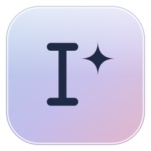

# Glossly

**Highlight text anywhere on Windows. Glossly offers the right next step.**

Ask about it, save it, reply to it, find out who's in it, turn it into tasks and events, or chart it, without leaving the app you're in.

[](../../releases/latest)


[Download](#install) · [Features](#features) · [Privacy](#privacy) · [Build from source](#build-from-source) · [Docs](#documentation)

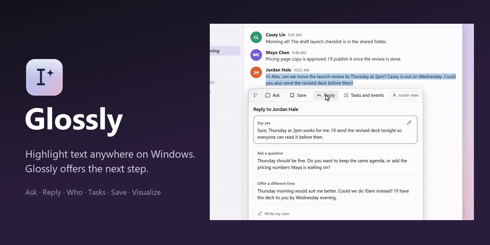

</div>

## Why Glossly

Most of what you read on a computer asks something of you: a question to answer, a date to remember, a name you half know, a table you'd understand better as a chart. Glossly sits quietly in the tray. When you select text, a small pill appears next to it. Open it and Glossly reads what you selected, works out what kind of text it is (a message, an email thread, a table, an article, code), and puts the two most useful actions next to Ask and Save.

It works in any app that shows text: chat and email apps, browsers, documents, PDFs, terminals. Nothing is sent anywhere until you pick an action, and you can keep everything on your computer with a local model.

## Features

### Reply in your own voice

Select a message and get three drafts that answer it, each taking a different line (say yes, ask a question, suggest another time). Glossly reads the conversation to know who wrote what and what's being asked, and learns your style from the drafts you pick and edit, separately for chat and email. **Insert** puts the reply in the message box; nothing is ever sent for you.

<p align="center">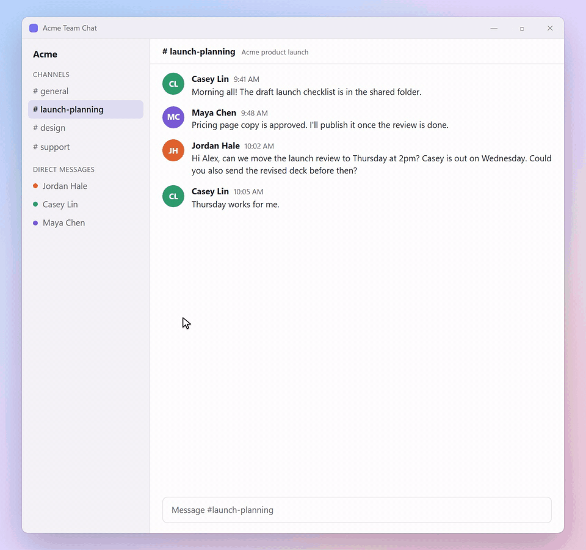</p>

### Who is this

A card for each person in what you selected: who they are to you, your notes, what you owe each other, and your last messages. New people can be added in one click, with their name, email, and handle filled in from the text.

<p align="center">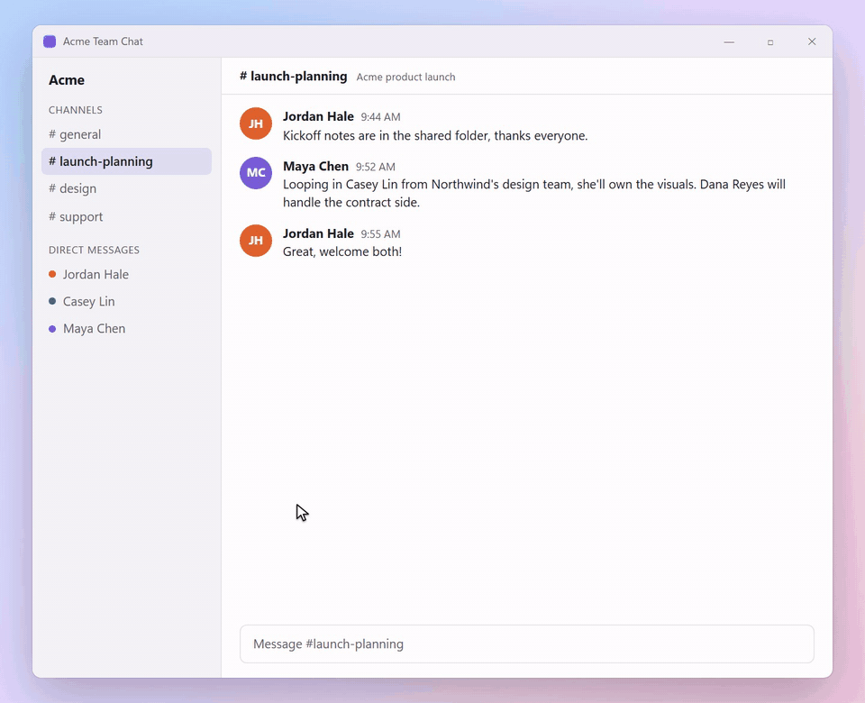</p>

### Tasks and events

Promises, requests, and todos ("could you send the deck before then?") become tasks with due dates and reminders, and meetings become calendar events. Glossly also notices when a message finishes or moves something you already track. Everything lands in Settings, in full Tasks and Calendar views.

<p align="center">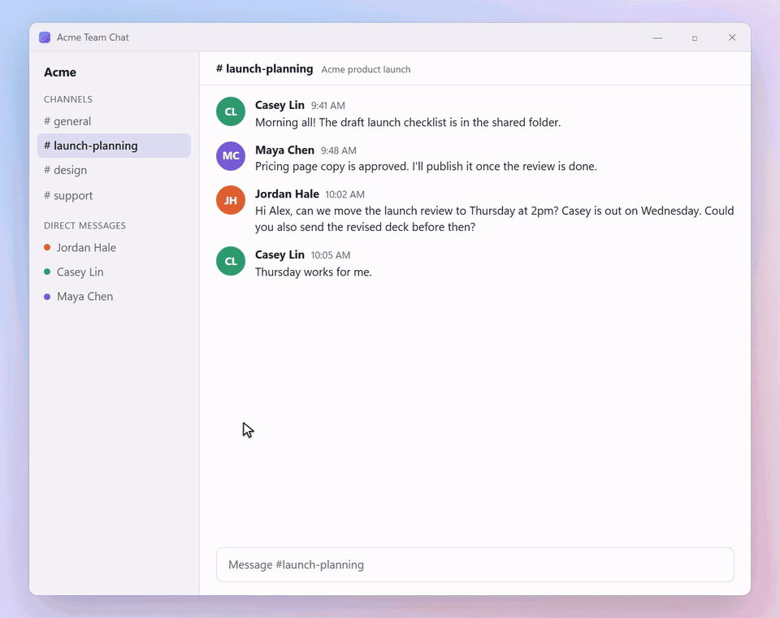</p>

### Ask

Ask anything about what you selected and get the answer right below it. Glossly brings in the text around your selection and your related saved notes, and "remember that…" saves a note for later.

<p align="center">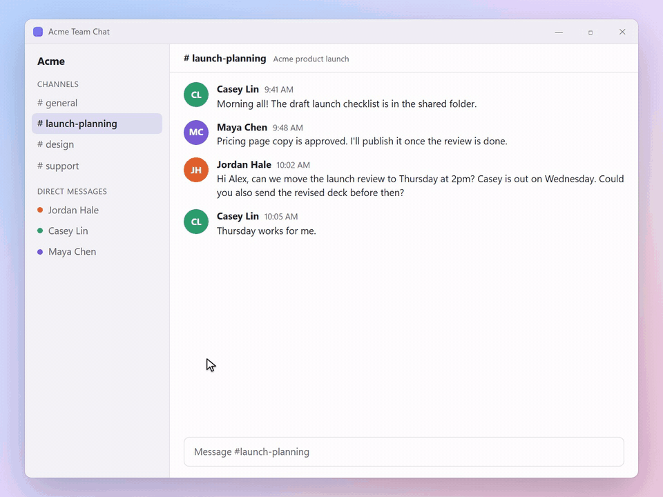</p>

### Save and Recall

Save a highlight in one click (or automatically), sorted into a collection. Later, when you select something related, a badge shows the notes that match by meaning or by the people and companies in them. Search and matching run on your computer.

<p align="center">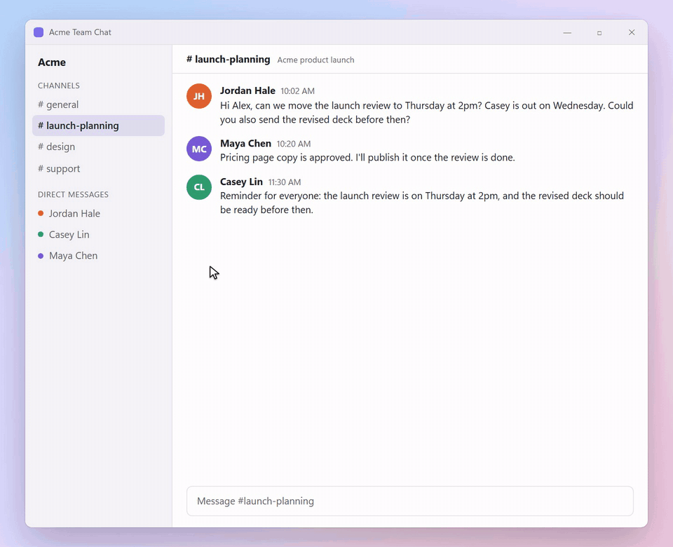</p>

### Visualize

Select a table (from a spreadsheet, a web page, Markdown, or a CSV) and get a clean chart. The chart is drawn by code straight from the table's rows; the model only picks the kind of chart and the columns.

<p align="center">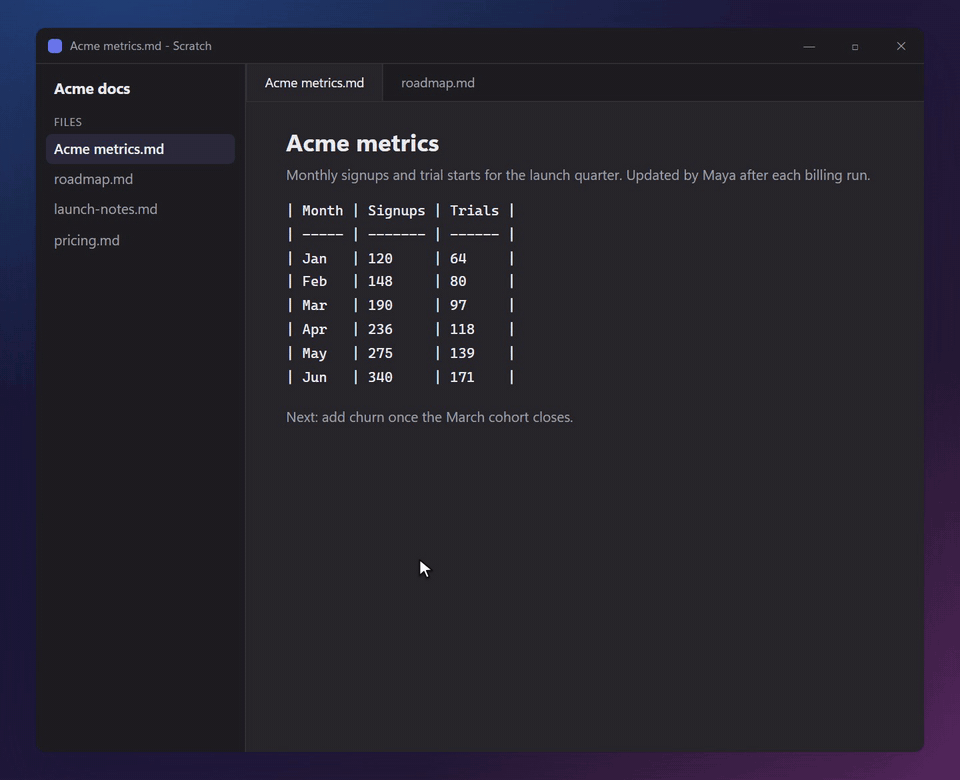</p>

### And more

- **Search** everything you saved, your people, and open tasks: press the hotkey with nothing selected.
- **Paste snippets** you saved recently, or have Glossly **write them up** for the field you're typing in.
- **Settings** has full Tasks and Calendar views, your people and saved items, model choices, privacy controls, and local usage metrics, in light and dark.

<p align="center">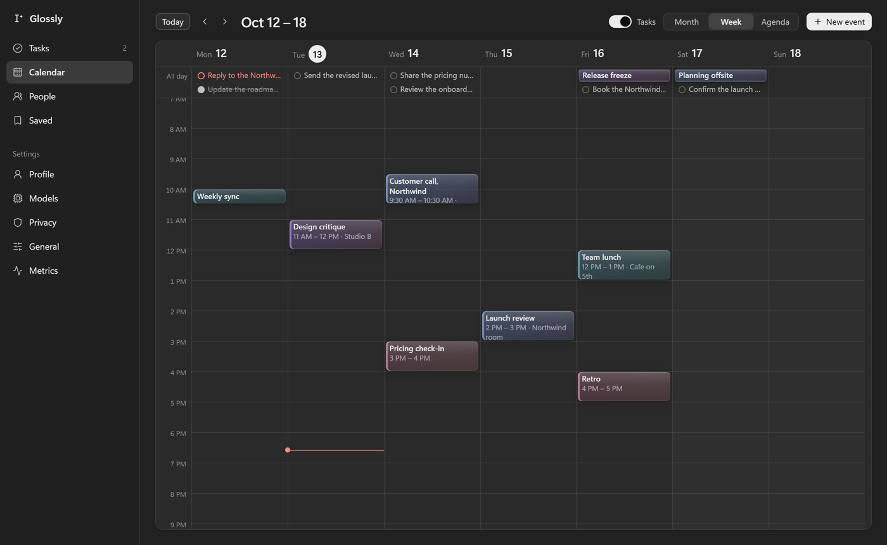</p>
<p align="center">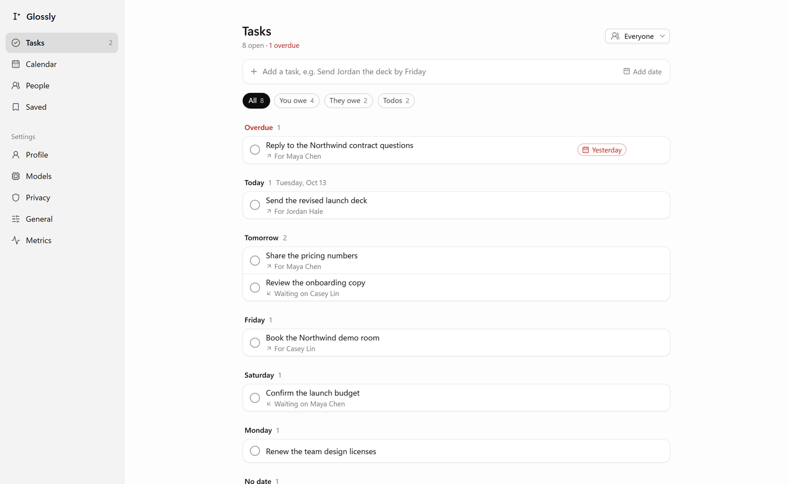</p>

## How it works

1. **Select** text with the mouse, as you normally would. A small pill appears below the selection (or press <kbd>Ctrl</kbd>+<kbd>Alt</kbd>+<kbd>Space</kbd>).
2. **Open the bar.** Ask and Save are always there. The other two buttons are picked for this text: Reply and Who is this on a message from someone else, Tasks on a request with a date, Visualize on a table. Everything else is under More.
3. **Act.** Each action opens a panel in place. Press <kbd>Esc</kbd> to step back, or just click away.

Glossly reads selections through Windows UI Automation, so your clipboard stays untouched, and it never reads password fields or watches what you type. Apps that don't expose their text that way still work through the hotkey, which copies the selection and puts your clipboard back.

## Install

1. Download **`Glossly-Setup-<version>.exe`** from the [latest release](../../releases/latest).
2. Run it. Glossly installs for your user account (no admin rights) and adds itself to the Start Menu.
3. Setup walks you through the rest: where models run, adding a key, your name (so Glossly knows which messages are yours), and a quick try.

> [!NOTE]
> The installer isn't code-signed yet, so Windows SmartScreen may say "Windows protected your PC". Choose **More info**, then **Run anyway**. Some antivirus apps also scan new unsigned apps on first run.

**Updates** download in the background. When one is ready, Settings > General shows **Restart to update**, and it also installs the next time you quit.

<details>
<summary>Settings > General, with Updates</summary>
<br>
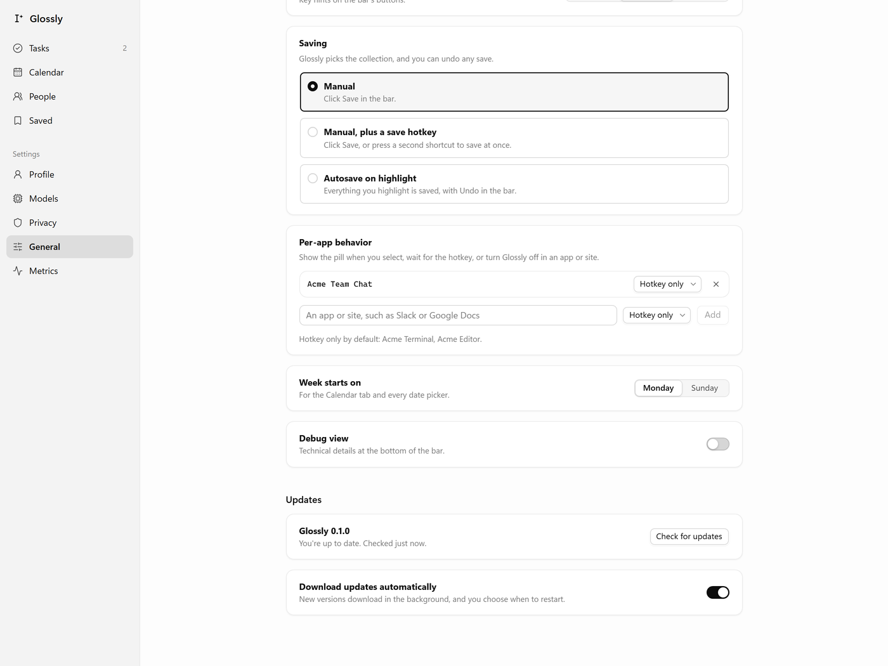
</details>

### Requirements

- Windows 11, x64.
- A model provider, any one of:
  - a [Groq](https://console.groq.com/keys) key (the free tier is enough for everyday use),
  - an OpenAI or Anthropic key,
  - a local model through [Ollama](https://ollama.com) or [LM Studio](https://lmstudio.ai), for fully offline use.

Glossly gives each kind of job its own model: a quick one for picking actions, a small one for reading conversations, tasks, and charts, and a stronger one for Ask and Reply. Setup picks them for you, and you can change any of them in Settings > Models.

## Privacy

Glossly is built so you decide what leaves your computer.

- **Nothing is sent until you act.** Selecting text shows the pill and nothing else. Opening the bar sends the selection to your model provider to pick actions; choosing an action sends what that action needs.
- **Local only mode** keeps everything on your computer: a local model does the work, and features that would need a cloud model say so instead.
- **Your data stays local.** Saved items, people, tasks, the calendar, and search embeddings live in a SQLite database in `%APPDATA%\Glossly`. Search runs on a small embedding model on your computer.
- **Keys are encrypted** with Windows' data protection (Electron `safeStorage`) and only ever sent to their own provider.
- **No password fields, no keylogging.** Password fields are never read, and the keyboard is never hooked.
- **No telemetry.** Usage metrics are counts and timings, stored locally and shown in Settings > Metrics. Logs hold codes and timings, never your text.
- **Block any app.** Password managers are blocked by default; add any app or site in Settings > Privacy, or switch Glossly to hotkey-only there.
- **Export or delete everything** from Settings at any time.

## Keyboard

| Keys | What it does |
| --- | --- |
| <kbd>Ctrl</kbd>+<kbd>Alt</kbd>+<kbd>Space</kbd> | Open the bar on the selection, or search when nothing is selected (configurable) |
| <kbd>1</kbd> to <kbd>4</kbd> | Run the bar's buttons by position |
| <kbd>Enter</kbd> | Run the highlighted button |
| <kbd>Tab</kbd> | Open the menu (More actions, Settings) |
| <kbd>Esc</kbd> | Close the menu, then the panel, then the bar |
| <kbd>Ctrl</kbd>+<kbd>Alt</kbd>+<kbd>S</kbd> | Save the selection at once (optional, in Settings > General) |

## Build from source

You need Windows 11, [Node.js 24](https://nodejs.org), [pnpm 12](https://pnpm.io) (via Corepack), and the [.NET 10 SDK](https://dotnet.microsoft.com/download) for the selection helper.

```powershell
corepack enable
pnpm install
pnpm dev          # builds the helper and starts the app with hot reload
```

| Command | What it does |
| --- | --- |
| `pnpm dev` | Run the app in development |
| `pnpm build` | Production build into `packages/shell-electron/out` |
| `pnpm test` | Unit tests (Vitest) |
| `pnpm typecheck` | TypeScript across the workspace |
| `pnpm dist` | Build the Windows installer into `packages/shell-electron/dist` |
| `pnpm eval` | Model evals (needs `GROQ_API_KEY`; uses your rate limits) |

### Project layout

```text
packages/
  core/            OS-neutral logic: capture rules, routing, actions, prompts, people, tasks, storage
  ui/              React UI for the overlay (pill, bar, panels) and the settings window
  shell-electron/  Electron main process: windows, tray, hotkeys, IPC, updates, packaging
helpers/windows/   C# helper that reads selections through UI Automation
fixtures/, evals/  Test fixtures and model evals
docs/              Architecture, decisions, features, testing, and design notes
```

### Built with

[Electron](https://www.electronjs.org) · [React](https://react.dev) · [TypeScript](https://www.typescriptlang.org) · [Vite](https://vite.dev) and [electron-vite](https://electron-vite.org) · [AI SDK](https://ai-sdk.dev) · [Zod](https://zod.dev) · SQLite with [sqlite-vec](https://github.com/asg017/sqlite-vec) · [Transformers.js](https://huggingface.co/docs/transformers.js) (local embeddings) · [Vega-Lite](https://vega.github.io/vega-lite/) · [FlaUI](https://github.com/FlaUI/FlaUI) on .NET · [electron-builder](https://www.electron.build) · [Vitest](https://vitest.dev)

## Roadmap

- [x] Selection capture, the pill, and the bar
- [x] Ask, Save, Recall, and Search
- [x] People, Who is this, and Reply that learns your style
- [x] Tasks, calendar events, and reminders
- [x] Visualize
- [x] Local models and Local only mode
- [x] Installer and automatic updates
- [ ] Code-signed installer
- [ ] Google Calendar sync
- [ ] macOS

## Documentation

| Doc | What's in it |
| --- | --- |
| [`docs/features.md`](docs/features.md) | Every feature in detail, and how far each has been tested |
| [`docs/architecture.md`](docs/architecture.md) | Processes, packages, the capture pipeline, routing, the model layer, data |
| [`docs/decisions.md`](docs/decisions.md) | Every design decision, numbered, with the reasons |
| [`docs/testing.md`](docs/testing.md) | Unit tests, eval results, and how the app is checked live |
| [`STATUS.md`](STATUS.md) | Where the project stands, with eval numbers |
| [`docs/HANDOFF.md`](docs/HANDOFF.md) | The current state and next steps, for contributors |

## License

No license has been chosen yet, so all rights are reserved for now. You're welcome to read the code and try the app; please ask before reusing it.
